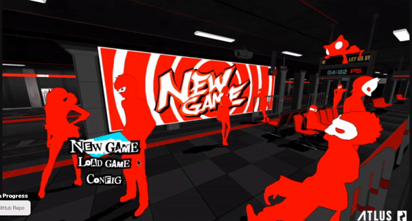

<!-- ========================================== -->
<!-- 🔴 BANNER                                 -->
<!-- ========================================== -->

  <h1>Hari Kishan Singh</h1>
  
BCA student at IMS Ghaziabad (2025–2028) · Aspiring AI/ML Engineer

<!-- ========================================== -->

  <b>BCA student at IMS Ghaziabad (2025–2028) · Aspiring AI/ML Engineer</b>

 

  <h3>Learning through building</h3>
  
Python · Machine Learning · Applied AI · Generative AI

 

<!-- 🎮 DUAL ANIMATED PERSONA 5 SHOWCASE BATTLE -->
<!-- ========================================== -->
<table align="center" width="100%">
  <tr>
    <td width="50%" align="center" valign="middle">
      
    </td>
    <td width="50%" align="center" valign="middle">
      
    </td>
  </tr>
</table>

<b>Current focus: Python, machine learning, and applied AI projects</b>

 

<!-- ========================================== -->
<!-- 🎭 WHO AM I?                               -->
<!-- ========================================== -->

  <h2>🎩 WHO AM I?</h2>

I'm a BCA student at IMS Ghaziabad (2025–2028), building my foundation in Python, machine learning, and applied AI. My public projects are learning projects, and I aim to document their setup and behavior clearly.

One current project is a small Python retrieval demo. It chunks a fictional knowledge base, embeds the chunks, compares vectors with cosine similarity, and passes retrieved context to a chat model. See the repository below for its setup and limitations.

 

<!-- Quick Connect Badges -->

  <strong>⚔️ CONNECT WITH THE PHANTOM THIEVES</strong>
    
  
  
  
  

 

<!-- Persona 5 Calling Card Alert -->

> [!CAUTION]
> ### 🃏 CALLING CARD: TO ALL INNOVATORS
> 
> *"Sir Harry Kishan Singh, master of datasets and neural networks.*
> *Code is never finished — it only gets sharper, faster, and more intelligent.*
> *What you see here is forged through relentless practice, deep curiosity, and unstoppable persistence.*
> *We have decided to steal your boredom and ignite your ambition."*
> 
> **— The Phantom Thieves of Hearts**

 

<!-- ========================================== -->
<!-- 🚀 FLAGSHIP PROJECTS                       -->
<!-- ========================================== -->

  

 

  <table align="center" width="100%">
    <tr><td>
      <a href="https://github.com/HarryInData/vecter_memory"><b>Vector Memory Workshop — Python Retrieval Demo</b></a> 
      A small Python retrieval demo that chunks a fictional knowledge base, stores embeddings in a local JSON file, ranks matches by cosine similarity, and provides retrieved context to a chat model. It does not use a vector database.
    </td></tr>
  </table>

 

<!-- 🎮 GAMES & INTERACTIVE ANIMATIONS          -->
<!-- ========================================== -->

  

 

<!-- Snake Contribution Game Animation (Local High-Speed SVG) -->

  <h3>🐍 GitHub Contribution Grid Snake Eater</h3>
  <picture>
    <source media="(prefers-color-scheme: dark)" srcset="./assets/images/github-snake-dark.svg">
    <source media="(prefers-color-scheme: light)" srcset="./assets/images/github-snake.svg">
    
  </picture>

 

<!-- Interactive Mini Games & Easter Eggs -->

<b>🕹️ Click to Expand Retro Arcade &amp; Easter Eggs <i>(Interactive Zone)</i></b>

 

| 🎮 Mini Game | 🕹️ Description | 🚀 Launch |
| :--- | :--- | :---: |
| **Chrome Dino Runner** | Jump obstacles in the classic retro runner | [**▶️ Play Now**](https://chromedino.com/) |
| **Pac-Man Retro** | Navigate mazes and avoid the ghosts | [**▶️ Play Now**](https://www.google.com/logos/2010/pacman10-i.html) |
| **Connect 4** | Challenge opponents in strategy grid | [**▶️ Play Now**](https://connect4.games/) |
| **Persona 5 All-Out Attack** | Experience the iconic Persona 5 victory splash | [**⚡ Watch**](https://www.youtube.com/watch?v=bwNZvS1qKvo) |

 

<!-- ========================================== -->
<!-- GitHub contribution activity -->

  <a href="https://github.com/HarryInData/graphs/contributors">View GitHub contribution activity</a>

 

  <h2>Currently learning</h2>
  
Python · Machine Learning · Generative AI · Data Science

  
<a href="https://github.com/HarryInData?tab=repositories">Explore my repositories</a>

 

<!-- 🎵 CURRENT SOUNDTRACK // METAVERSE         -->
<!-- ========================================== -->

  

 

<!-- ========================================== -->
<!-- 🩸 FOOTER                                  -->
<!-- ========================================== -->

  
   
  Designed with Persona 5 Crimson &amp; Black Aesthetic • Built by <b>Harry (HarryInData)</b>

