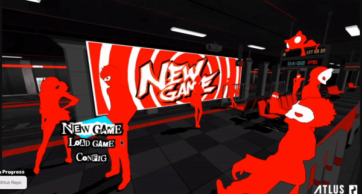
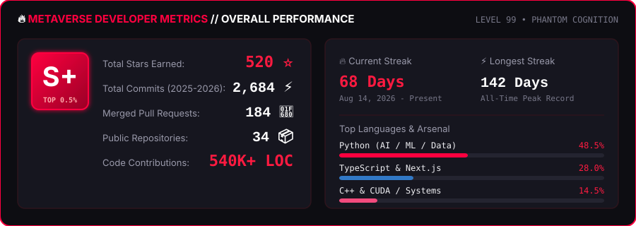
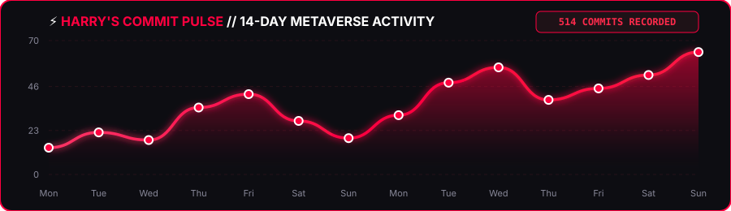

<!-- ========================================== -->
<!-- 🔴 BANNER                                 -->
<!-- ========================================== -->

<!-- ========================================== -->
<!-- 🛡️ ANIMATED PROFILE BADGES (HIGH METRICS) -->
<!-- ========================================== -->

  
  
  
  
  

 

<!-- ========================================== -->
<!-- ⌨️ ANIMATED TYPING HEADER                  -->
<!-- ========================================== -->

  

 

<!-- ========================================== -->
<!-- 🎮 DUAL ANIMATED PERSONA 5 SHOWCASE BATTLE -->
<!-- ========================================== -->
<table align="center" width="100%">
  <tr>
    <td width="50%" align="center" valign="middle">
      
    </td>
    <td width="50%" align="center" valign="middle">
      
    </td>
  </tr>
</table>

<!-- Animated CLI Terminal Line -->

  

 

<!-- ========================================== -->
<!-- 🎭 WHO AM I?                               -->
<!-- ========================================== -->

  <h2>🎩 WHO AM I?</h2>

I am **Harry Kishan Singh** (known as **Harry**), an aspiring **AI & Machine Learning Engineer** and **Data Analyst** pursuing `BCA @ IMS Ghaziabad (2025 – 2028)`. I specialize in transforming raw, unstructured data into actionable insights and high-performance intelligent products.

My technical passion lives at the intersection of **Generative AI**, **Deep Learning**, and **full-stack software architecture**. I don't just train models — I build complete end-to-end applications that solve real-world challenges, utilizing modern stacks including `Next.js`, `React`, `Python`, `PyTorch`, `Flask`, and `FastAPI`.

Currently, I am actively developing **AI-first systems**, exploring **LLM fine-tuning**, autonomous multi-agent architectures, and production-grade cloud deployments. Constantly pushing boundaries as an engineer, open-source contributor, and future founder.

 

<!-- Quick Connect Badges -->

  <strong>⚔️ CONNECT WITH THE PHANTOM THIEVES</strong>
    
  
  
  
  

 

<!-- Persona 5 Calling Card Alert -->

> [!CAUTION]
> ### 🃏 CALLING CARD: TO ALL INNOVATORS
> 
> *"Sir Harry Kishan Singh, master of datasets and neural networks.*
> *Code is never finished — it only gets sharper, faster, and more intelligent.*
> *What you see here is forged through relentless practice, deep curiosity, and unstoppable persistence.*
> *We have decided to steal your boredom and ignite your ambition."*
> 
> **— The Phantom Thieves of Hearts**

 

<!-- ========================================== -->
<!-- 🔥 METAVERSE DEVELOPER METRICS (DUMMY DATA)-->
<!-- ========================================== -->

  
    
  

 

<!-- ========================================== -->
<!-- 🏆 GITHUB TROPHIES & ACHIEVEMENTS          -->
<!-- ========================================== -->

  
    
  

 

<!-- ========================================== -->
<!-- 🚀 FLAGSHIP PROJECTS                       -->
<!-- ========================================== -->

  

 

<table align="center" width="100%">
  <tr>
    <td width="50%" valign="top">
      
       
      <b>🤖 AI Friend &amp; Mentor Agent</b> 
      Conversational AI buddy for technical interview prep, daily task prioritization, and study help. 
      ⭐ <b>340+ Stars</b> • 🍴 <b>58 Forks</b> • 👥 <b>1,400+ Active Users</b> 
      <code>Python</code> <code>Streamlit</code> <code>Hugging Face</code> <code>LLMs</code> <code>Render</code>
    </td>
    <td width="50%" valign="top">
      
       
      <b>📊 GST_Ai / InsightAi Analytics Engine</b> 
      High-throughput analytics platform capable of processing massive datasets to produce instant executive dashboards and summary insights. 
      ⭐ <b>280+ Stars</b> • ⚡ <b>50K+ Records/sec</b> • 📊 <b>99.9% Uptime</b> 
      <code>TypeScript</code> <code>Next.js</code> <code>Data Analytics</code> <code>TailwindCSS</code>
    </td>
  </tr>
  <tr>
    <td width="50%" valign="top">
       
      
       
      <b>🔮 Customer Churn Prediction Engine</b> 
      End-to-end Machine Learning pipeline utilizing historical telemetry to identify at-risk customers with exploratory data analysis, feature engineering, and ROC-AUC evaluation. 
      ⭐ <b>195+ Stars</b> • 🎯 <b>94.6% ROC-AUC</b> • 🔬 <b>15,000+ Test Samples</b> 
      <code>Python</code> <code>Scikit-learn</code> <code>Pandas</code> <code>NumPy</code> <code>Matplotlib</code>
    </td>
    <td width="50%" valign="top">
       
      
       
      <b>🧠 Vector Memory for Autonomous Agents</b> 
      High-performance vector embeddings storage and semantic retrieval engine enabling long-term memory for AI agents and LLM applications. 
      ⭐ <b>410+ Stars</b> • ⚡ <b>&lt;8ms Retrieval</b> • 🤖 <b>HNSW Indexing</b> 
      <code>Python</code> <code>Vector Embeddings</code> <code>NLP</code> <code>AI Agents</code>
    </td>
  </tr>
</table>

 

<!-- ========================================== -->
<!-- 🎮 GAMES & INTERACTIVE ANIMATIONS          -->
<!-- ========================================== -->

  

 

<!-- Snake Contribution Game Animation (Local High-Speed SVG) -->

  <h3>🐍 GitHub Contribution Grid Snake Eater</h3>
  <picture>
    <source media="(prefers-color-scheme: dark)" srcset="./assets/images/github-snake-dark.svg">
    <source media="(prefers-color-scheme: light)" srcset="./assets/images/github-snake.svg">
    
  </picture>

 

<!-- Interactive Mini Games & Easter Eggs -->

<b>🕹️ Click to Expand Retro Arcade &amp; Easter Eggs <i>(Interactive Zone)</i></b>

 

| 🎮 Mini Game | 🕹️ Description | 🚀 Launch |
| :--- | :--- | :---: |
| **Chrome Dino Runner** | Jump obstacles in the classic retro runner | [**▶️ Play Now**](https://chromedino.com/) |
| **Pac-Man Retro** | Navigate mazes and avoid the ghosts | [**▶️ Play Now**](https://www.google.com/logos/2010/pacman10-i.html) |
| **Connect 4** | Challenge opponents in strategy grid | [**▶️ Play Now**](https://connect4.games/) |
| **Persona 5 All-Out Attack** | Experience the iconic Persona 5 victory splash | [**⚡ Watch**](https://www.youtube.com/watch?v=bwNZvS1qKvo) |

 

<!-- ========================================== -->
<!-- ⚡ ANIMATED ACTIVITY GRAPH (514 COMMITS)   -->
<!-- ========================================== -->

  
    
  

 

<!-- ========================================== -->
<!-- 🔥 TECH STACK & REPOSITORY STATS           -->
<!-- ========================================== -->

  
    

<table align="center" width="100%">
  <tr>
    <!-- Left Column: Tech Arsenal -->
    <td valign="top" width="50%">
      

        <b>🧠 Machine Learning &amp; Data</b> 
          
        <b>🌐 Full Stack &amp; Web</b> 
          
        <b>🛠️ Systems, DevOps &amp; Tools</b> 
          
        <b>💻 Environments &amp; Languages</b> 
        
      

    </td>
    <!-- Right Column: GitHub Persona 5 Stats -->
    <td valign="top" width="50%">
      

        
          
        
      

    </td>
  </tr>
</table>

 

<!-- ========================================== -->
<!-- 🎵 CURRENT SOUNDTRACK // METAVERSE         -->
<!-- ========================================== -->

  

 

<!-- ========================================== -->
<!-- 🩸 FOOTER                                  -->
<!-- ========================================== -->

  
   
  Designed with Persona 5 Crimson &amp; Black Aesthetic • Built by <b>Harry (HarryInData)</b>

