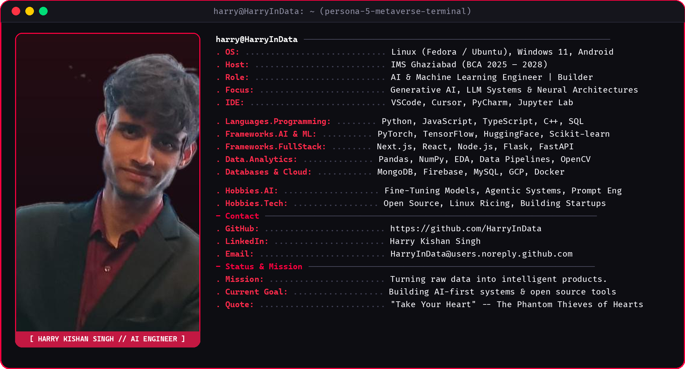
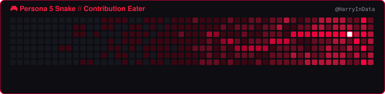

<!-- Banner  -->

<!-- Profile Badges -->

  
  
  
  

 

<!-- Animated Persona 5 Typing Header -->

  

 

<!-- ========================================== -->
<!-- 💻 NEOFETCH TERMINAL PROFILE (PORTRAIT) -->
<!-- ========================================== -->

  

 

<!-- ========================================== -->
<!-- 🎭 WHO AM I? (PERSONA 5 THEMED) -->
<!-- ========================================== -->

  <h2>🎩 WHO AM I?</h2>

I am **Harry Kishan Singh** (known as **Harry**), an aspiring **AI & Machine Learning Engineer** and **Data Analyst** currently pursuing `BCA @ IMS Ghaziabad (2025 – 2028)`. I specialize in transforming raw, unstructured data into actionable insights and high-performance intelligent products.

My technical passion lives at the intersection of **Generative AI**, **Deep Learning**, and **full-stack software architecture**. I don't just train models — I build complete end-to-end applications that solve real-world challenges, utilizing modern stacks including `Next.js`, `React`, `Python`, `PyTorch`, `Flask`, and `FastAPI`.

Currently, I am actively developing **AI-first systems**, exploring **LLM fine-tuning**, autonomous multi-agent architectures, and production-grade cloud deployments. Constantly pushing boundaries as an engineer, open-source contributor, and future founder.

 

<!-- Quick Connect Buttons -->

  <strong>⚔️ CONNECT WITH THE PHANTOM THIEVES</strong>
    
  <!-- GitHub -->
  
  <!-- LinkedIn -->
  
  <!-- Gmail -->
  
  <!-- Kaggle -->
  

 

<!-- Persona 5 Calling Card Alert -->

> [!CAUTION]
> ### 🃏 CALLING CARD: TO ALL INNOVATORS
> 
> *"Sir Harry Kishan Singh, master of datasets and neural networks.*
> *Code is never finished — it only gets sharper, faster, and more intelligent.*
> *What you see here is forged through relentless practice, deep curiosity, and unstoppable persistence.*
> *We have decided to steal your boredom and ignite your ambition."*
> 
> **— The Phantom Thieves of Hearts**

 

<!-- ========================================== -->
<!-- 🎮 GAMES & INTERACTIVE ANIMATIONS -->
<!-- ========================================== -->

  

 

<!-- Snake Contribution Game Animation -->

  <h3>🐍 GitHub Contribution Grid Snake Eater</h3>
  <picture>
    <source media="(prefers-color-scheme: dark)" srcset="https://raw.githubusercontent.com/HarryInData/HarryInData/output/github-snake-dark.svg">
    <source media="(prefers-color-scheme: light)" srcset="https://raw.githubusercontent.com/HarryInData/HarryInData/output/github-snake.svg">
    
  </picture>

 

<!-- Interactive Mini Games & Easter Eggs -->

<b>🕹️ Click to Expand Retro Arcade & Easter Eggs <i>(Interactive Zone)</i></b>

 

| 🎮 Mini Game | 🕹️ Description | 🚀 Launch |
| :--- | :--- | :---: |
| **Chrome Dino Runner** | Jump obstacles in the classic retro runner | [**▶️ Play Now**](https://chromedino.com/) |
| **Pac-Man Retro** | Navigate mazes and avoid the ghosts | [**▶️ Play Now**](https://www.google.com/logos/2010/pacman10-i.html) |
| **Connect 4** | Challenge opponents in strategy grid | [**▶️ Play Now**](https://connect4.games/) |
| **Persona 5 All-Out Attack** | Experience the iconic Persona 5 victory splash | [**⚡ Watch**](https://www.youtube.com/watch?v=bwNZvS1qKvo) |

 

 

<!-- ========================================== -->
<!-- ⚡ MY CONTRIBUTIONS GRAPH -->
<!-- ========================================== -->

  
    

 

<!-- ========================================== -->
<!-- 🔥 TECH STACK & REPOSITORY STATS -->
<!-- ========================================== -->

  
    

<table align="center" width="100%">
  <tr>
    <!-- Left Column: Tech Arsenal -->
    <td valign="top" width="50%">
      

        <b>🧠 Machine Learning & Data</b> 
          
        <b>🌐 Full Stack & Web</b> 
          
        <b>🛠️ Systems, DevOps & Tools</b> 
          
        <b>💻 Environments & Languages</b> 
        
      

    </td>
    <!-- Right Column: GitHub Persona 5 Stats -->
    <td valign="top" width="50%">
      

        
          
        
      

    </td>
  </tr>
</table>

 

<!-- ========================================== -->
<!-- 🏆 TROPHIES & TOP LANGUAGES -->
<!-- ========================================== -->

  <h3>🏆 GITHUB ACHIEVEMENTS & TROPHIES</h3>
  
  
    
  
  <h3>📊 TOP LANGUAGES REPERTORY</h3>
  

 

<!-- ========================================== -->
<!-- 🎵 CURRENT SOUNDTRACK // METAVERSE -->
<!-- ========================================== -->

  

 

<!-- ========================================== -->
<!-- 🩸 FOOTER -->
<!-- ========================================== -->

  
   
  Designed with Persona 5 Crimson &amp; Black Aesthetic • Built by <b>Harry (HarryInData)</b>

